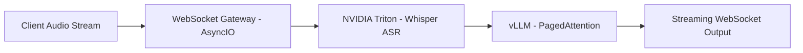

# Production-Grade Low-Latency Inference Pipeline: NVIDIA Triton (Whisper) + vLLM Serving

## Overview

This repository is a portable reference architecture for real-time speech understanding. A Python asyncio gateway accepts PCM audio over WebSockets, performs voice endpointing and backpressure in the event loop, and delegates all GPU work to separate serving runtimes:

- NVIDIA Triton runs Faster-Whisper ASR.
- vLLM serves an OpenAI-compatible instruction model with PagedAttention, continuous batching, prefix caching, and chunked prefill.
- Nginx terminates the public WebSocket route and disables proxy buffering.

No model weights, credentials, private datasets, or deployment-specific domains are included.

## Architecture



## Key Engineering Decisions

### vLLM and PagedAttention

Token streaming is served by vLLM rather than a synchronous model call. PagedAttention keeps KV-cache memory in fixed pages, which allows many active sequences to share GPU memory without reserving a worst-case contiguous buffer per request. Continuous batching admits new sessions between decoding steps, while prefix caching reduces repeated prompt work. The gateway consumes server-sent events and forwards each delta as soon as it arrives.

### Keep Python off the GPU critical path

The gateway does not load PyTorch or a speech model. It performs lightweight PCM framing, RMS endpointing, queue accounting, and network I/O. Triton owns ASR execution, including its Python backend and CUDA runtime. This keeps GIL-bound application work away from the GPU kernels and lets each runtime scale or restart independently.

### Audio backpressure

Each connection has a bounded segment queue. When ASR or LLM latency exceeds the incoming speech rate, the oldest queued segment is discarded and counted. The gateway also bounds raw audio frames before endpointing. Dropping old audio is deliberate: a live session should stay near the present instead of building an ever-growing delay. `/metrics` exposes accepted frames, dropped frames, and TTFT percentiles.

## Benchmark and Latency Profile

The numbers below are **engineering targets for capacity planning**. They are not a claim about a particular hardware run. Execute `benchmark_stress_test.py` on the target GPUs and replace this table with its JSON output before citing measured results.

| Profile | Target |
|---|---|
| Time to first token | `< 350 ms` after endpointing on a warm local GPU pair |
| Sustained sessions | `25+` concurrent WebSocket streams |
| Frame-loss policy | Oldest audio is dropped only when the bounded queue is full |
| Tail latency | Report measured `p50`, `p95`, and `p99` TTFT |
| GPU placement | ASR and LLM pinned to separate GPUs |
| VRAM | Set by the selected Whisper checkpoint and vLLM `gpu-memory-utilization` |

## Repository Layout

```text
Dockerfile                  Gateway image
Dockerfile.triton           Triton image with Faster-Whisper backend
docker-compose.yml          Triton, vLLM, gateway, and Nginx
server_matrix.py            Async WebSocket gateway
benchmark_stress_test.py    Concurrent-session benchmark
model_repository/           Triton model configuration, no weights
nginx/nginx.conf            WebSocket reverse proxy
```

## Quickstart

Requirements: Linux, Docker Engine, Docker Compose v2, and the NVIDIA Container Toolkit. Two GPUs are assumed. For one GPU, set `TRITON_GPU` and `VLLM_GPU` carefully and reduce model size; do not schedule both runtimes onto the same device unless its memory budget has been measured.

```bash
git clone <your-public-repository-url>
cd realtime-llm-triton-vllm-serving
cp .env.example .env
# Edit HF_TOKEN and model choices. Do not commit .env.
docker compose up -d --build
```

Wait until both model servers are healthy, then run:

```bash
python -m pip install -r requirements.txt
python benchmark_stress_test.py \
  --url ws://127.0.0.1:8088/ws/stream \
  --metrics-url http://127.0.0.1:8080/metrics \
  --clients 25
```

The benchmark prints per-client TTFT and a final JSON report containing `p50`, `p95`, `p99`, errors, and the gateway's dropped-frame counter.

## WebSocket Contract

Send binary frames containing little-endian mono PCM16 at 16 kHz. Send `{"type":"flush"}` at the end of a turn. The server emits:

- `transcript`: ASR text for one endpointed segment.
- `ttft`: milliseconds from segment start to the first LLM token.
- `token`: one streamed response delta.
- `turn_complete`: the LLM response has finished.
- `error`: the segment failed and the session remains open.

## Security Boundary

Triton, vLLM, the gateway, and Nginx are published on `127.0.0.1`. The default edge port is `8088`; set `NGINX_PORT=80` only on a host where this stack is the public proxy, then terminate TLS in Nginx. Keep Hugging Face tokens in `.env` or a secret manager. This repository intentionally contains neither private keys nor production endpoints.

Do not start this compose file on a machine that is already serving another inference workload. Both GPU services reserve a device for the duration of the stack.

## License

Add an explicit license before publishing the repository.
